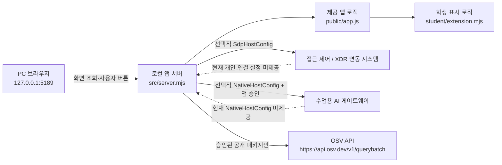

# 벌레먹은딸기 학생 실행 설명서

이 문서는 21단계 「학생용 실행 설명서와 시스템 구성도」를 위해 작성한 학생 문서입니다. 제공된 README와 `docs/` 문서는 수정하지 않고, 현재 저장소의 실행 파일·학생 코드·직접 확인 결과를 기준으로 정리합니다.

## 1. 목적과 현재 범위

「벌레먹은딸기」는 로컬 브라우저에서 실행하는 보안 Agent 화면입니다. 사용자는 자신의 로그인·기기·세션 상태, 업무 앱 접근 판정, 최근 보안 기록, 진단 정보, AI 연결/설명 상태, 조치 상태, 설치 패키지 취약점 조회 상태를 확인합니다.

현재 학생 작성 코드는 `student/extension.mjs`의 표시 함수입니다. 학생 코드는 제공 서버의 인증·접근 제어·XDR·AI·조치 집행·OSV 조회 기능을 대체하지 않습니다. 실제 외부 연결에 필요한 개인 설정이나 운영 권한이 제공되지 않은 기능은 이 문서에서 **미확인**으로 표시합니다.

## 2. 필요 프로그램과 확인한 버전

| 항목 | 현재 기준 | 확인 상태 |
|---|---|---|
| OS | Windows | 실제 사용 환경 |
| PowerShell | Windows PowerShell에서 실행 | 실제 버전 번호는 아직 기록하지 않음 |
| Node.js | `package.json`의 `engines.node` = `24.19.0` | 현재 PC에서 `node --version` → `v24.21.0` 직접 확인. 제공 실행 도구는 Node.js 22~24를 허용하고 `v24.19.0`을 수업 기준으로 안내함 |
| Git | 저장소 갱신·커밋에 사용 | 실제 사용 확인, 버전 번호는 기록하지 않음 |
| 브라우저 | PC 브라우저 | `http://127.0.0.1:5189/` 직접 접속 확인 |
| npm 외부 의존성 | `package.json`에 별도 dependencies가 없음 | 소스 확인 |

현재 저장소의 `on-client/package-lock.json`은 제출된 `main`에서 확인되지 않았습니다. 20단계 실제 화면도 `PROJECT_NOT_CONFIGURED`를 표시했으므로, 패키지 조회가 구성되었다고 가정하지 않습니다.

## 3. 실제 작업 위치와 폴더 구조

현재 사용자 PC에서 확인한 저장소 위치:

```text
D:\Kai_Python\공동방어전\choi-bujang-secret-vault
```

앱 폴더:

```text
D:\Kai_Python\공동방어전\choi-bujang-secret-vault\on-client
```

다른 PC에서는 저장소를 둔 위치가 달라도 되며, 아래 명령은 **해당 저장소의 `on-client` 폴더**에서 실행합니다.

중요 파일:

```text
choi-bujang-secret-vault/
└─ on-client/
   ├─ package.json
   ├─ src/
   │  └─ server.mjs                  # 제공 로컬 앱 서버
   ├─ public/
   │  ├─ app.js                      # 제공 화면 상태/요청/취소/재조회 흐름
   │  └─ vulnerabilities-view.mjs    # 제공 패키지 조회 응답 검증/기본 표시
   ├─ student/
   │  └─ extension.mjs               # 13~20단계 학생 표시 함수
   ├─ tools/
   │  └─ start-alekov.ps1            # 제공 실행 도구
   └─ docs/
      └─ STUDENT_RUNBOOK.md           # 이 문서
```

## 4. 새 PowerShell에서 실행하기

### 4.1 앱 폴더에서 PowerShell 열기

파일 탐색기에서 다음 폴더를 엽니다.

```text
D:\Kai_Python\공동방어전\choi-bujang-secret-vault\on-client
```

주소 표시줄에 `powershell`을 입력해 새 PowerShell을 엽니다.

먼저 실제 Node.js 버전을 기록합니다.

```powershell
node --version
```

프로젝트의 수업 기준 버전은 `v24.19.0`입니다. 21단계 직접 확인에서 현재 PC는 `v24.21.0`이었습니다. 제공 실행 도구는 Node.js 22~24를 실행 허용 범위로 두고, 정확히 `v24.19.0`이 아니면 참고 안내를 출력합니다.

### 4.2 학생 파일 문법 확인

```powershell
npm run check
```

현재 PC의 PowerShell에서는 실행 정책 때문에 `npm.ps1`이 차단되는 것을 직접 확인했습니다. 전역 실행 정책을 바꾸지 않고 아래처럼 Windows 명령 래퍼를 사용합니다.

```powershell
npm.cmd run check
```

Git Bash에서는 기존처럼 `npm run check`를 사용할 수 있습니다. 현재까지 실제 개발 환경에서는 학생 파일 문법 검사가 성공했고 다음 스크립트가 실행되는 것을 확인했습니다.

```text
node --check student/extension.mjs
```

### 4.3 공식 기본 실행

```powershell
powershell -NoProfile -ExecutionPolicy Bypass -File .\tools\start-alekov.ps1
```

소스상 기본 포트는 `5189`이며 브라우저 주소는 다음과 같습니다.

```text
http://127.0.0.1:5189/
```

제공 실행 도구의 정상 시작 안내는 다음 형태입니다.

```text
케셰브가 켜졌습니다. 브라우저에서 http://127.0.0.1:5189/ 을 여세요.
서버가 응답한 것만 확인했습니다. AI 연결 상태는 화면에서 따로 확인해 주세요.
```

이 기본 실행 절차는 제공 소스와 공식 문서에서 확인했고, 21단계 새 PowerShell에서 직접 실행해 아래 결과를 확인했습니다.

```text
참고: 지금 Node.js 는 v24.21.0 입니다. 수업 기준은 v24.19.0 입니다.
케셰브 연결 확인: http://127.0.0.1:5189
케셰브가 켜졌습니다. 브라우저에서 http://127.0.0.1:5189/ 을 여세요.
서버가 응답한 것만 확인했습니다. AI 연결 상태는 화면에서 따로 확인해 주세요.
끄려면 이 창에서 Ctrl+C 를 누르세요.
```

### 4.4 예제 데이터로 화면 확인

실제 개발 중에는 다음 명령을 직접 실행해 확인했습니다.

```powershell
npm run demo
```

직접 확인한 시작 신호:

```text
케셰브 예제: http://127.0.0.1:5189
```

`demo`는 예제 자료이며 실제 SDP/AI/운영 시스템 연결 성공을 뜻하지 않습니다.

### 4.5 종료와 재실행

실행 중인 PowerShell에서:

```text
Ctrl+C
```

로 서버를 종료합니다. 다시 실행하려면 같은 `on-client` 폴더에서 4.3 또는 4.4의 명령을 다시 실행합니다.

기본 포트 `5189`가 이미 사용 중이면 다른 프로그램을 강제로 종료하지 않고, 제공 실행 도구의 포트 옵션을 사용합니다.

```powershell
powershell -NoProfile -ExecutionPolicy Bypass -File .\tools\start-alekov.ps1 -Port 5190
```

이 포트 변경 방법은 제공 실행 도구에서 확인한 절차이며 현재 사용자 PC에서 직접 시험한 결과는 아직 미확인입니다.

## 5. 시스템 구성도



관계 설명:

- 브라우저는 로컬 앱 서버 `127.0.0.1`에만 직접 요청합니다.
- `public/app.js`는 제공 코드이며 로딩·취소·세대 변경·접근 판정·AI 설명·조치 요청·패키지 조회 상태를 관리합니다.
- `student/extension.mjs`는 제공 코드가 전달한 안전한 입력을 DOM으로 표시합니다.
- 실제 접근 제어/XDR 연결은 담당자가 제공하는 `SdpHostConfig`가 필요한 별도 경로입니다.
- 실제 계정/AI 앱 연결은 담당자가 제공하는 `NativeHostConfig`와 승인 절차가 필요한 별도 경로입니다.
- OSV 조회는 서버가 승인한 공개 패키지에 한해 수행합니다. 학생이 임의로 패키지 이름이나 회사 내부 패키지를 외부로 전송하지 않습니다.
- 비밀 설정값·토큰·비밀번호·API 키는 이 문서와 저장소에 기록하지 않습니다.

## 6. 제공 코드와 학생 작성 코드 경계

| 영역 | 파일/함수 | 담당 |
|---|---|---|
| 로컬 HTTP 서버·API 라우팅 | `src/server.mjs` | 제공 코드 |
| 화면 전체 상태·요청·취소·세대 관리 | `public/app.js` | 제공 코드 |
| OSV 응답 정규화/검증 | `public/vulnerabilities-view.mjs` | 제공 코드 |
| 실행 전 Node/폴더/포트 확인 | `tools/start-alekov.ps1` | 제공 코드 |
| 로그인·기기·세션 표시 | `renderIdentity` | 학생 작성 |
| 업무 앱 판정 표시 | `renderDecision` | 학생 작성 |
| 보안 기록 필터·상세 | `renderEvents` | 학생 작성 |
| 상태·알림·진단 정보 | `renderStatus` | 학생 작성 |
| 설치 패키지/OSV 상태 | `renderVulnerabilities` | 학생 작성 |
| AI 연결 점검 표시 | `renderAiConnection` | 학생 작성 |
| 선택 사건 AI 설명 표시 | `renderExplanation` | 학생 작성 |
| 조치 요청/효과 상태 표시 | `renderAction` | 학생 작성 |

학생 코드는 인증 티켓을 만들거나 저장하지 않고, AI 키를 입력받지 않으며, 조치 집행용 POST를 새로 만들지 않습니다. 실제 요청과 확인 티켓은 제공 코드 경계 안에 있습니다.

## 7. 지금까지 직접 확인한 기능

| 기능 | 직접 확인 결과 | 구분 |
|---|---|---|
| 공식 기본 실행 | 새 PowerShell에서 `start-alekov.ps1` 실행 후 `http://127.0.0.1:5189/` 화면 표시 확인. 기본 연결 상태는 `연결 없음` | 실제 화면 |
| demo 실행 | `npm run demo` 후 `http://127.0.0.1:5189` 실행 | 실제 화면 |
| 로그인/기기/세션 | demo 사용자·기기·세션 표시, 서버 중지 시 기존 값 대신 오류 표시 | 실제 화면 |
| 업무 앱 판정 | allow / deny / challenge 및 서버 중지 오류 표시 | 실제 화면 |
| 보안 기록 | demo `event-01` 상세와 근거·규칙·상태 표시 | 실제 화면 |
| 진단 정보 | 학생 `도움정보 복사`에서 requestId/component/version/checkedAt/engine.mode/engine.code만 복사됨 | 실제 화면 |
| 서버 재연결 | 서버 중지 후 오류, 다시 실행 후 정상 상태 복귀 | 실제 화면 |
| AI 계정 연결 | `NATIVE_HOST_DISABLED` 확인 | 실제 화면. 실제 AI 연결 성공은 미확인 |
| AI 사건 설명 | 표시 함수와 근거 바인딩은 코드 확인 | 실제 AI 연결이 없어 실제 설명 성공은 미확인 |
| 조치 상태 | `아직 미실행(idle)`, 지원 조치가 없으면 준비 버튼이 없는 상태 | 실제 화면. prepared 이후 실제 집행은 미확인 |
| 패키지 조회 | `PROJECT_NOT_CONFIGURED`, 학생 화면의 `조회 준비 미완료(not_configured)` | 실제 화면 |
| 정확 설치 버전/OSV 항목 | complete/partial 표시 코드는 구현됨 | 현재 프로젝트 설정이 없어 실제 패키지/취약점 결과는 미확인 |

## 8. 학생 표시 함수별 현재 상태

| 함수 | 현재 구현 | 직접 확인하지 못한 부분 |
|---|---|---|
| `renderIdentity` | 로딩·오류·빈 상태·사용자/기기/세션 표시 | 별도 운영 SDP 연결 |
| `renderDecision` | allow/deny/challenge/unknown, 실패와 deny 분리 | 운영 SDP의 실제 정책 판정 |
| `renderEvents` | 필터, 상세, 근거/규칙/상태 표시 | 여러 실제 사건으로 필터 감소, 실제 빈 배열 |
| `renderStatus` | 기기/세션/알림/진단·안전 복사 | 실제 supportedActions가 있는 사건 |
| `renderAiConnection` | idle/loading/ok/error와 test/verified, 수동 재점검 안내 | NativeHostConfig가 없어 실제 verified/model 응답 |
| `renderExplanation` | 사건·근거 ID·규칙·unknown·제안/미실행 구분 | 실제 AI 설명 호출 |
| `renderAction` | idle/loading/prepared/executing/pending/succeeded/denied/failed/unknown/error/expired 구분 | 실제 조치 준비·ACK·효과 관측 |
| `renderVulnerabilities` | complete/partial/not_checked/not_configured/unverifiable, 정확 버전/OSV 표시 | 현재는 PROJECT_NOT_CONFIGURED라 실제 패키지 행 |

## 9. 장애 상황과 확인 순서

| 화면/코드 | 의미 | 확인 순서와 복구 |
|---|---|---|
| PowerShell에서 `npm.ps1` 실행 정책 오류 | PowerShell이 Node 설치의 `npm.ps1` 래퍼를 차단 | 전역 실행 정책을 변경하지 않고 `npm.cmd run check` 사용 |
| 브라우저가 `127.0.0.1:5189`에 연결되지 않음 | 로컬 서버 미실행 또는 포트 문제 | 실행 PowerShell 확인 → 서버가 꺼졌으면 같은 명령으로 재실행 → 포트 충돌이면 `-Port 5190` 등 제공 옵션 사용 |
| `NATIVE_HOST_DISABLED` | 계정 연결용 Native host가 준비되지 않음 | 학생 코드 수정이나 API 키 입력 금지 → 담당자가 `NativeHostConfig`를 제공했는지 확인 → 없으면 실제 AI 연결은 미확인으로 유지 |
| AI 점검 timeout/rate limit/cancel | 연결 결과를 확정할 수 없음 | 자동 재시도하지 않고 제공 화면의 점검 버튼으로 사용자가 직접 다시 확인 |
| `PROJECT_NOT_CONFIGURED` | 패키지 조회 대상 프로젝트 설정 미구성 | 취약점 없음으로 해석하지 않음 → 의존성을 낮추거나 설정을 임의 변경하지 않음 → 운영자 설정이 제공될 때까지 미확인 |
| 패키지 조회 loading/error/cancel | 현재 조회 결과가 아직 없거나 실패 | 이전 표를 현재 결과로 사용하지 않음 → 사용자가 직접 다시 조회 |
| 지원 조치 버튼 없음 | 현재 사건의 `supportedActions`가 빈 배열 | 정상 상태. 실제 조치를 만들거나 시험 집행하지 않음 |
| 조치 `unknown` | 서버 효과 결과를 확정하지 못함 | 성공/효과 없음으로 단정하지 않고 제공 화면의 결과 재조회만 사용 |
| demo 표시 | 예제 엔진 사용 | 실제 SDP/AI/운영 권한 연결 성공으로 기록하지 않음 |

## 10. 외부 연결 설정의 현재 상태

현재 사용자에게는 다음 개인 설정이 제공되지 않았습니다.

- `NativeHostConfig`: 미제공. 실제 계정 연결/AI 앱 승인 미확인.
- `SdpHostConfig`: 실제 운영 연결용 개인 설정으로 사용될 수 있으나 현재 직접 연결 성공은 확인하지 않음.
- 패키지 조회 대상/승인 공개 패키지 설정: 현재 화면에서 `PROJECT_NOT_CONFIGURED`.

설정 파일을 받더라도 파일 내용, 인증서, 토큰, 키는 저장소·문서·캡처에 복사하지 않습니다. 담당자가 안내한 파일을 저장소 밖에 두고 제공 실행 옵션만 사용합니다.

## 11. 21단계 직접 확인 절차

기존 작업을 보존한 상태에서 새 PowerShell을 열어 아래 순서로 확인합니다.

1. `on-client` 폴더에서 `node --version`을 실행해 실제 버전을 기록합니다.
2. PowerShell에서 `npm.cmd run check`를 실행해 `node --check student/extension.mjs`가 오류 없이 끝나는 것을 직접 확인했습니다. (`npm run check`는 현재 PC에서 `npm.ps1` 실행 정책 오류가 확인됨)
3. `powershell -NoProfile -ExecutionPolicy Bypass -File .\tools\start-alekov.ps1`를 실행합니다.
4. 출력된 브라우저 주소를 직접 열고 보호 현황이 표시되는지 확인합니다.
5. `Ctrl+C`로 종료하고 같은 명령으로 다시 실행해 재실행되는지 확인합니다.
6. 문서의 경로·명령·버튼 이름이 실제 화면과 다른 경우 문서를 수정한 뒤 커밋합니다.

이 절차에서 확인하지 못한 연결은 성공으로 기록하지 않습니다.

## 12. 21·22단계 커밋과 원문 제출 메모

21·22단계는 현재 워크벤치의 13~20단계용 「포털 제출 준비」와 절차가 다릅니다.

- 학생 문서와 해당 단계 변경을 커밋한 뒤 과제 화면에 저장소 주소와 **실제 40자리 커밋**을 입력합니다.
- 제출 전 Git 최상위 폴더는 다음 위치입니다.

```text
D:\Kai_Python\공동방어전\choi-bujang-secret-vault
```

- Git 최상위와 실제 커밋은 다음 명령으로 확인할 수 있습니다.

```powershell
git rev-parse --show-toplevel
git status
git rev-parse HEAD
```

- 비공개 저장소 원문 전달이 필요하면 과제 화면의 「비공개 저장소 원문 준비 방법」에서 **그 시점에 제공되는 `student-source-cli.mjs` 명령을 그대로 사용**합니다.
- 현재 저장소 안에는 그 도구의 실제 경로와 포털이 발급하는 명령이 없으므로 이 문서에서 명령을 추측해 만들지 않습니다.
- 도구 ZIP과 생성 JSON은 프로젝트 밖에 둡니다.
- 원문 전달 성공과 AI 판정 통과는 서로 다른 상태입니다. 실제 판정 결과를 받기 전에는 통과로 기록하지 않습니다.

## 13. 지원하지 않거나 아직 확인하지 않은 동작

다음 항목은 현재 직접 확인하지 않았습니다.

- 운영 계정으로 Native host 연결 성공
- AI 앱 승인 후 `verified` 모델 점검 성공
- 실제 AI 사건 설명 성공
- 실제 보안 조치의 prepared → executing → pending → succeeded 전체 흐름
- 실제 `observation.effectApplied === true` 효과 관측
- 실제 설치 패키지의 complete/partial OSV 조회
- 새 PowerShell에서 Node.js `v24.21.0` 확인, `npm.cmd run check` 성공, 공식 `start-alekov.ps1` 실행 성공, 브라우저 화면 표시 및 기본 `연결 없음` 상태까지 직접 확인. 종료·재실행은 아직 미확인
- 21·22단계 비공개 원문 전달 도구의 실제 명령

이 항목들은 운영 설정이나 직접 확인 결과가 생긴 뒤에만 문서의 “확인됨” 상태로 변경합니다.
